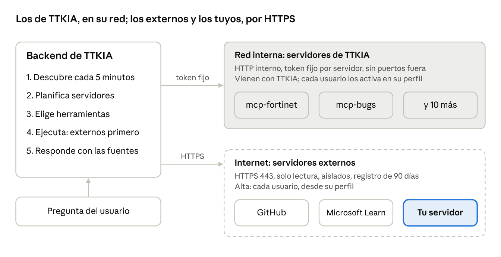

# Servidores MCP en TTKIA

Cómo conectar a TTKIA herramientas nuevas mediante MCP, por dos caminos:

1. **[Dar de alta un servidor de terceros](docs/terceros.md)** que ya existe (GitHub, Microsoft Learn…), desde tu perfil.
2. **[Escribir tu propio servidor](docs/servidor-propio.md)** a partir de tus scripts, alojarlo donde tengas sitio y darlo de alta igual.

Este repositorio trae la guía y una [plantilla](plantilla/) de servidor lista para copiar, probada con el SDK `mcp` 2.1.1 (el que usa TTKIA). Si algo no va, mira [problemas habituales](docs/problemas.md) o abre una incidencia.

## Qué es MCP

MCP (Model Context Protocol) es un protocolo abierto para que un asistente de IA use herramientas externas de forma estándar. Un **servidor MCP** publica una lista de herramientas, cada una con su nombre, una descripción, el esquema de sus argumentos y unas anotaciones (por ejemplo, si solo lee o si modifica algo). El asistente, que hace de **cliente**, lee esa lista, decide qué herramienta necesita para responder y la llama con los argumentos adecuados.

TTKIA ya funciona así con sus propios servidores (Fortinet, Check Point, Palo Alto, SD-WAN, Meraki, PSIRT, bugs de plataforma, ciclo de vida…). Cuando preguntas por la versión de un gestor o por los bugs de una versión, el asistente no lo sabe de memoria: elige la herramienta del servidor correspondiente, la ejecuta y responde con lo que devuelve.

Abrirlo a más servidores permite:

- **Añadir herramientas sin tocar TTKIA.** Un servidor se describe a sí mismo (qué hace, cuándo usarlo y cuándo no, qué herramientas tiene). TTKIA lo lee y lo tiene en cuenta junto a los demás.
- **Reutilizar lo que ya existe.** Muchos fabricantes y servicios publican ya su servidor MCP.
- **Convertir scripts en herramientas.** Un script que hoy ejecutas a mano puede ser una herramienta que el asistente usa cuando la pregunta lo pide, combinada con el resto en la misma respuesta.

## Cómo funciona en TTKIA



En cada pregunta, TTKIA:

1. **Descubre** lo que publica cada servidor (instrucciones y herramientas) y lo vuelve a leer periódicamente.
2. **Planifica** qué servidores necesita, entre los que tienes activos.
3. **Elige** las herramientas y sus argumentos, servidor a servidor, y las ejecuta. Los servidores externos van primero.
4. **Responde** con los resultados, citando de qué herramienta sale cada dato.

Hay dos tipos de servidores:

| Tipo | Quién lo da de alta | Quién lo ve |
| --- | --- | --- |
| Servidores de TTKIA | Ya vienen con TTKIA | Los usuarios de las verticales con acceso; cada uno los activa o desactiva en «MCP tools» de su perfil |
| Servidores externos, de terceros o tuyos | Cada usuario, desde su perfil, con el permiso «External MCP» | Solo quien lo da de alta |

## Qué admite TTKIA de un servidor externo

Un servidor externo, sea de un proveedor o tuyo, está fuera del control de TTKIA: lo que se le envía sale de Telefónica Tech y lo que devuelve no está revisado. Por eso:

| Regla | Qué significa |
| --- | --- |
| Solo lectura | Solo se pueden activar las herramientas que el servidor declara de solo lectura (`read_only_hint=True`). Las que escriben salen bloqueadas. |
| HTTPS público | Dirección `https://` en el puerto 443. No se admiten direcciones internas ni privadas. |
| Token Bearer | Sin token o con token Bearer. Los servidores que solo admiten inicio de sesión en el navegador (OAuth: Gmail, Google Drive, Notion…) todavía no se pueden conectar. |
| No ven tus sistemas | Lo que TTKIA ha consultado en sistemas internos durante esa respuesta no se le pasa al servidor externo. |
| Si cambia, se para | Si el servidor cambia sus herramientas o instrucciones, deja de usarse hasta que lo revises y lo apruebes de nuevo. |
| Límites | 5 servidores por usuario, 20 herramientas por servidor y 30 s por llamada. |
| Registro | Lo que se envía a cada servidor externo queda registrado. |

Aun así, la regla para el usuario es sencilla: **no uses un servidor externo en preguntas con datos de clientes**.

## Contenido del repositorio

```text
.
├── docs/
│   ├── terceros.md          caso 1: servidores de terceros (GitHub, Microsoft Learn)
│   ├── servidor-propio.md   caso 2: escribir, publicar y dar de alta el tuyo
│   ├── problemas.md         problemas habituales
│   └── img/
└── plantilla/               servidor de ejemplo listo para copiar
    ├── src/main.py
    ├── probar.py            prueba el servidor como lo haría TTKIA
    ├── requirements.txt
    ├── Dockerfile
    ├── docker-compose.yml   servidor + Caddy (HTTPS automático)
    ├── Caddyfile
    └── .env.example
```

## Licencia

[Apache-2.0](LICENSE)
