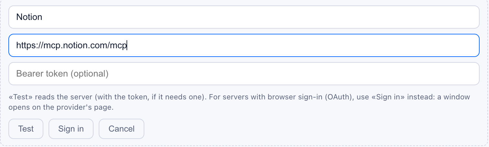
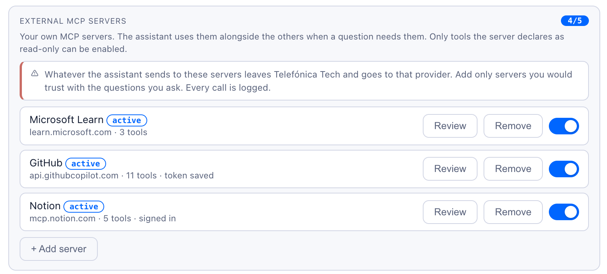

# Servidores con inicio de sesión (OAuth)

> **Próxima versión de TTKIA.** El inicio de sesión (botón **Sign in**) y las citas que enseñan la llamada exacta llegan con la próxima versión. Hasta entonces, en el perfil solo están **Test** y el token.

Algunos servidores MCP no funcionan con un token fijo: te piden que inicies sesión en su página, como cuando conectas una aplicación a tu cuenta. Es el caso de Notion. TTKIA los admite desde su perfil con el botón **Sign in**.

## Qué pasa al iniciar sesión

1. TTKIA pregunta al servidor cómo se inicia sesión. El servidor responde con la dirección de su servicio de autorización.
2. TTKIA se registra allí como aplicación, con el nombre «TTKIA». No hay que crear nada a mano.
3. Se abre una ventana con la página del proveedor. Ahí inicias sesión con **tu** cuenta y autorizas el acceso. TTKIA nunca ve tu contraseña.
4. El proveedor devuelve a TTKIA unas credenciales temporales. Se guardan cifradas y nunca vuelven al navegador.
5. Se abre la revisión para que elijas qué herramientas de solo lectura usa TTKIA, igual que con cualquier otro servidor.

A partir de ahí TTKIA renueva la sesión solo, sin que tengas que hacer nada. Si el proveedor la retira (cambias la contraseña, revocas el acceso o pasa demasiado tiempo), el servidor queda en «sign in required» y basta con volver a iniciar sesión.

TTKIA accede con **tus** permisos en el proveedor: ve lo que tú ves y nada más.

## Paso a paso

1. Abre tu perfil y baja hasta **External MCP servers**.
2. Pulsa **+ Add server** y escribe un nombre corto y la URL del servidor. Deja vacío el campo del token.
3. Pulsa **Sign in** (no «Test»). Se abre una ventana con la página del proveedor.
   - Si no se abre, el navegador la ha bloqueado: permite las ventanas emergentes para TTKIA y vuelve a pulsar.

   

   *Alta de Notion: sin token, con **Sign in** en vez de **Test**.*

4. Inicia sesión en el proveedor y autoriza el acceso. Algunos, como Notion, enseñan la dirección de TTKIA a la que volverán y piden que confirmes que confías en ella. Tienes 10 minutos.
5. La ventana termina sola. En el perfil verás «signed in» y se abrirá la lista de herramientas.
6. Marca solo las que vayas a usar y pulsa **Approve and use**. El servidor queda en «active».
7. Haz una pregunta que lo necesite. Los datos que vengan de sus herramientas salen citados en verde: al pulsar la cita ves la llamada exacta, con lo que se envió y lo que devolvió.

Para gestionarlo después:

- **Review** vuelve a leer el servidor con tu sesión y te deja aprobar de nuevo. Es obligatorio si ha pasado a «changed — review».
- **Sign in** aparece en la fila cuando la sesión ha caducado o se ha retirado («sign in required»). Vuelve a iniciarla; las herramientas aprobadas se mantienen.
- El interruptor lo desactiva sin borrarlo. Mientras falte iniciar sesión, no se puede activar.
- **Remove** lo elimina y borra las credenciales guardadas. La autorización sigue apareciendo en tu cuenta del proveedor: si quieres, retírala también allí.



*Notion queda como uno más: «signed in» en lugar de «token saved».*

## Ejemplo: Notion

Notion publica su servidor MCP en `https://mcp.notion.com/mcp`. Solo admite inicio de sesión.

1. Alta con nombre `notion`, esa URL y **Sign in**.
2. En la página de Notion, elige el espacio de trabajo. Notion enseña la dirección a la que volverá (la de TTKIA, terminada en `/auth/user-mcp-external/oauth/callback`): marca **Reconozco esta URL y confío en ella** y pulsa **Continuar**. TTKIA verá las páginas a las que tienes acceso.
3. La revisión muestra unas 65 herramientas, de las que unas 36 se declaran de solo lectura. Para consultar contenido bastan cinco:
   - **Search Notion**: busca páginas y bases de datos.
   - **Fetch Notion entities**: lee una página o una base de datos.
   - **Query Notion data sources**: consulta las filas de una base de datos.
   - **List recent pages** y **List favorite pages**.

   No hacen falta las de calendario y personas, las de memorias y agentes de Notion AI, las de control (comprobar acceso, siguientes pasos, versión completa), las descargas ni las Skills.

Preguntas de ejemplo:

```text
Busca en Notion la página del procedimiento de alta de sedes y resúmela
¿Qué equipos de Cisco aparecen como «en préstamo» en la base de datos Inventario LAB de Notion?
```

La segunda necesita varios pasos seguidos con el mismo servidor (buscar la base de datos, leer su estructura y consultar las filas). TTKIA los encadena dentro de la misma respuesta.

## Qué tiene que ofrecer el servidor

Sirve para comprobar si un proveedor se podrá conectar antes de intentarlo, o para quien publique su propio servidor con inicio de sesión.

| Requisito | Por qué |
| --- | --- |
| Responder `401` con la cabecera `WWW-Authenticate` y publicar sus metadatos de recurso protegido (RFC 9728) | Es como TTKIA averigua dónde se inicia sesión |
| Servicio de autorización con metadatos (RFC 8414 u OpenID Connect) | Ahí están las direcciones de autorización, token y registro |
| **Registro dinámico de clientes** (RFC 7591), que acepte un cliente público sin secreto | TTKIA se registra solo; no hay forma de darle un identificador de cliente a mano |
| PKCE con `S256` | Lo exige el estándar de MCP y lo usa TTKIA |
| Página de autorización en `https://` | TTKIA no abre otra cosa |
| Todas sus direcciones públicas | Como el servidor, también la de autorización, la de token y la de registro |
| Credenciales de renovación (*refresh token*), recomendadas | Sin ellas hay que volver a iniciar sesión cada vez que caduca el acceso |

Si el proveedor no ofrece registro dinámico y exige registrar antes una aplicación en su consola, **no se puede conectar**. Es el caso de Google (Gmail, Drive) y Microsoft 365.

Para un servidor propio no compensa: un token Bearer, como en la [plantilla](../plantilla/), es más sencillo y basta.

## Qué guarda TTKIA

- Las credenciales del proveedor y el registro de TTKIA como aplicación, **cifrados**. Nunca vuelven al navegador ni salen en los registros.
- Lo que el servidor publicó al iniciar sesión (sus direcciones de autorización y token), para renovar sin volver a preguntarlo.
- Si dejas a medias un inicio de sesión, no se toca el que ya funcionaba: solo se guarda al terminar.
