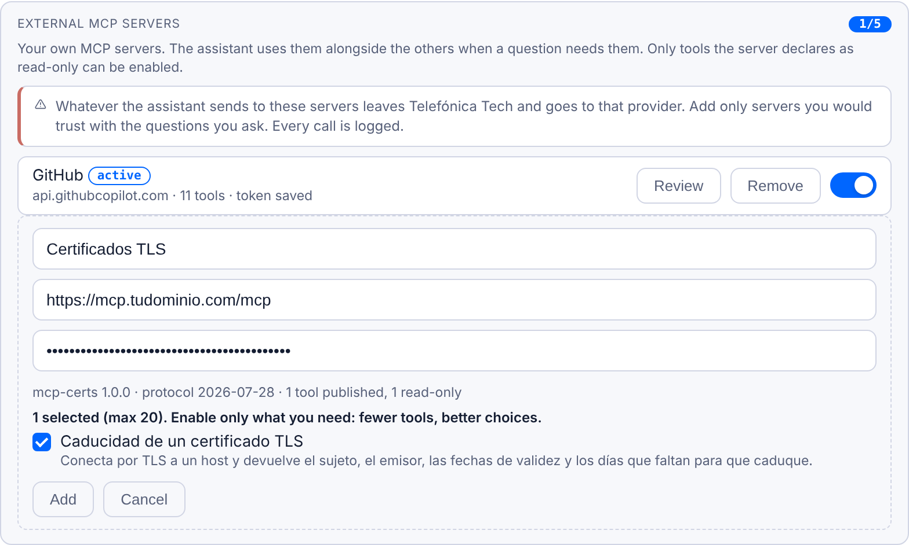

# Caso 2: escribir tu propio servidor MCP

Si tienes scripts que quieres que use TTKIA, los conviertes en un servidor MCP con la [plantilla](../plantilla/), lo publicas tú donde tengas sitio, con HTTPS y token, y lo das de alta desde tu perfil igual que un [servidor de terceros](terceros.md).

## Lo que tiene que cumplir

Para TTKIA tu servidor es un servidor externo más, así que se le aplican las mismas reglas:

- **HTTPS público en el 443, con certificado válido.** No se admiten direcciones privadas, internas o de VPN: un servidor en tu portátil o en una máquina de la red interna no sirve.
- **Token Bearer.** El que configures en el servidor y pongas al darlo de alta. TTKIA también admite [inicio de sesión](inicio-de-sesion.md#qué-tiene-que-ofrecer-el-servidor) (OAuth), pero para un servidor propio no compensa montarlo: el token basta.
- **Herramientas de solo lectura** (`read_only_hint=True`). Las demás no se pueden activar.
- **Respuesta en menos de 30 s** y como mucho 20 herramientas.

Lo que publicas queda expuesto en internet. Protégelo con un token largo, no devuelvas credenciales en las respuestas y, si tu script consulta sistemas de un cliente o de la red interna, asegúrate antes de que está permitido sacarlo.

## La plantilla

El ejemplo es `mcp-certs`, un servidor con una herramienta `cert_expiry` que comprueba cuándo caduca el certificado TLS de un host: el típico script de operaciones que hoy se ejecuta a mano.

Copia la carpeta [`plantilla/`](../plantilla/) y edita [`src/main.py`](../plantilla/src/main.py). Tiene cuatro partes:

1. **Instrucciones** (`INSTRUCTIONS`): qué hace el servidor, cuándo usarlo, cuándo no y cómo usar sus herramientas. Es lo que lee el modelo para decidir si lo usa.
2. **Herramientas** (`_tools()`): nombre, título, descripción, esquema de argumentos y anotaciones.
3. **La lógica** (`call_tool()`): aquí va tu script.
4. **Cableado MCP**: igual en todos los servidores; no hay que tocarlo.

## Cómo meter tu script en la parte 3

- **Es Python y tiene funciones.** Importa la función y llámala desde `call_tool`. Si es síncrona (sockets, `requests`, Netmiko, un SDK de fabricante), pásala por `asyncio.to_thread(...)` para no bloquear el servidor.
- **Es un comando o un script de shell.** Usa `asyncio.create_subprocess_exec("mi_script.sh", host, ...)` con los argumentos como lista y `asyncio.wait_for(..., timeout=...)`. Nunca `shell=True` ni cadenas montadas con lo que envía el modelo: los argumentos vienen de un LLM y hay que tratarlos como entrada no fiable.
- **Necesita credenciales.** Por variables de entorno, nunca como argumento de la herramienta ni en la descripción.
- **Una herramienta por pregunta que respondes,** no una por función del script. Si hay que pedir varias cosas del mismo equipo, una herramienta que las acepte en lote (`sections=[...]`) ahorra llamadas.

## Reglas para que el modelo la use bien

| Regla | Por qué |
| --- | --- |
| Instrucciones con «Cuándo usarlo», «Cuándo no usarlo» y «Cómo usar las herramientas» | El planificador decide con ellas si usar tu servidor; el selector, qué herramienta y con qué argumentos. Se recortan a 1.200 caracteres en el plan: lo importante, al principio. |
| Devolver siempre JSON con `status` (`ok`, `error`, `not_found`…) | TTKIA pasa al modelo el texto de la respuesta; un error con explicación le deja seguir trabajando. |
| Un resultado vacío explica qué habría devuelto algo | Un cero mudo se lee como «no existe». Mejor: qué hay en total, qué valores casan, cómo reintentar. |
| Terminar antes de 30 s | TTKIA corta ahí y el modelo recibe un error en vez de tu resultado. Si puede tardar más, presupuesto propio y resultado parcial honesto. |
| Respuestas por debajo de 150.000 caracteres | Es el tope por resultado: lo que pase se recorta. Mejor filtrar en el servidor. |
| Describir los datos, no interpretarlos | Nada de convenciones de un cliente en el código («el prefijo es la sede»). |
| Sin IP internas ni nombres de cliente en descripciones e instrucciones | Lo que publica el servidor lo leen el modelo y el registro. |
| Si cambias herramientas o instrucciones, vuelve a revisarlo en el perfil | TTKIA detecta el cambio, lo pasa a «changed» y deja de usarlo hasta que pulses **Review** y lo apruebes. |

## Probarlo en tu equipo

Desde la carpeta `plantilla/`, instala las dependencias:

```bash
pip install -r requirements.txt
```

Arranca el servidor con un token cualquiera:

```bash
MCP_AUTH_TOKEN=prueba123 python src/main.py
```

En otra terminal, comprueba que `/health` responde y que `/mcp` exige token (debe dar 401):

```bash
curl -s localhost:8000/health
curl -s -o /dev/null -w "%{http_code}\n" -X POST localhost:8000/mcp
```

Y habla con él como lo haría TTKIA con [`probar.py`](../plantilla/probar.py), que lee las instrucciones, comprueba que cada herramienta es de solo lectura y hace una llamada:

```bash
python probar.py http://localhost:8000/mcp prueba123 cert_expiry '{"host": "github.com"}'
```

Salida esperada: el servidor `mcp-certs 1.0.0`, sus instrucciones, `✓ cert_expiry solo lectura=True esquema raíz=object` y un JSON con `"status": "ok"` y los días que faltan para la caducidad. Si alguna herramienta sale con `✗`, TTKIA no la dejará activar.

## Publicarlo con HTTPS

Necesitas una máquina con IP pública (una VM en la nube que uses, por ejemplo), un nombre DNS que apunte a ella y los puertos 80 y 443 abiertos. La plantilla trae [`docker-compose.yml`](../plantilla/docker-compose.yml) con el servidor y Caddy delante: Caddy obtiene y renueva el certificado solo (Let's Encrypt usa el 80 para validarlo). El servidor MCP no publica puertos: solo se llega a él a través de Caddy.

1. Cambia `mcp.tudominio.com` por tu nombre en el [`Caddyfile`](../plantilla/Caddyfile).
2. Genera un token:

```bash
python3 -c "import secrets; print(secrets.token_urlsafe(32))"
```

3. Copia `.env.example` a `.env` y pon el token en `MCP_AUTH_TOKEN`:

```bash
cp .env.example .env
```

4. Arráncalo:

```bash
docker compose up -d --build
```

5. Compruébalo desde fuera, ya por HTTPS:

```bash
curl -s https://mcp.tudominio.com/health
python probar.py https://mcp.tudominio.com/mcp <token> cert_expiry '{"host": "github.com"}'
```

## Darlo de alta en TTKIA

Igual que en el [caso 1](terceros.md#paso-a-paso):

1. Perfil → **External MCP servers** → **+ Add server**.
2. Nombre `certs`, URL `https://mcp.tudominio.com/mcp` y el token.
3. **Test**: debe salir `cert_expiry` como activable. Si sale bloqueada, le falta `read_only_hint=True`.
4. Márcala y pulsa **Add**.
5. Pregunta: «¿Cuándo caduca el certificado de www.telefonica.com?». En las fuentes debe aparecer `x_certs__cert_expiry`.



*Alta de `mcp-certs` tras pulsar Test: TTKIA lee el servidor, el protocolo y su herramienta de solo lectura.*

## Lista de comprobación

- [ ] Instrucciones con «Cuándo usarlo», «Cuándo no usarlo» y «Cómo usar las herramientas»
- [ ] Cada herramienta con título, descripción, esquema de raíz `object` y `read_only_hint=True`
- [ ] Respuestas en JSON con `status`; los vacíos y los errores explican qué hacer
- [ ] Responde en menos de 30 s y con menos de 150.000 caracteres
- [ ] Credenciales por variables de entorno; sin IP internas ni nombres de cliente en lo que publica
- [ ] Comandos externos con lista de argumentos, sin `shell=True`
- [ ] `probar.py` pasa en local y, ya publicado, contra la URL `https://`
- [ ] HTTPS público en el 443 con certificado válido y token largo
- [ ] Permitido sacar fuera lo que consulta, si toca sistemas de un cliente o de la red interna
- [ ] Dado de alta en el perfil, con solo las herramientas que necesitas
