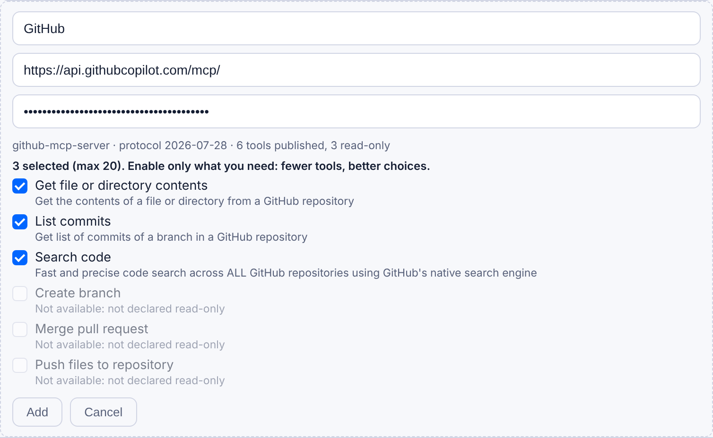
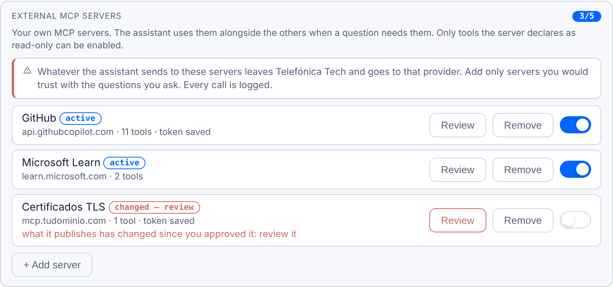

# Caso 1: añadir un servidor MCP de terceros

Cualquier usuario con el permiso «External MCP» puede dar de alta desde su perfil un servidor MCP público por HTTPS (sin credenciales, con token Bearer o con inicio de sesión) y elegir cuáles de sus herramientas de solo lectura usa TTKIA.

> **Próxima versión de TTKIA.** El inicio de sesión (botón **Sign in**, para Notion o Atlassian) y las citas que enseñan la llamada exacta llegan con la próxima versión. Hasta entonces, en el perfil solo están **Test** y el token.

## Antes de empezar

- **Permiso.** Pídeselo a un administrador de TTKIA. Sin él, la sección «External MCP servers» no aparece en tu perfil.
- **URL del servidor.** La del endpoint MCP del proveedor (streamable HTTP), no la de su web.
- **Cómo se identifica.** Mira en la documentación del proveedor qué pide:
  - Nada (Microsoft Learn): solo la URL.
  - Un token (GitHub): que sea de solo lectura y con el alcance más pequeño posible. TTKIA ya bloquea las herramientas que escriben, pero un token que no puede escribir es la segunda barrera.
  - Inicio de sesión en su página, OAuth (Notion): no hay token que copiar. Sigue [Servidores con inicio de sesión](inicio-de-sesion.md).

## Paso a paso (sin credenciales o con token)

Para los de inicio de sesión, el paso a paso está en [Servidores con inicio de sesión](inicio-de-sesion.md): cambia el paso 3 (**Sign in** en vez de **Test**).

1. Abre tu perfil y baja hasta **External MCP servers**, debajo de «MCP tools».
2. Pulsa **+ Add server** y escribe un nombre corto, la URL y, si hace falta, el token. El token se guarda cifrado y nunca vuelve al navegador.
3. Pulsa **Test**. TTKIA se conecta, lee lo que publica el servidor y te enseña sus herramientas. Las que no son de solo lectura salen deshabilitadas con el motivo.
4. Marca solo las herramientas que vayas a usar. Menos herramientas significa mejores elecciones del modelo.
5. Pulsa **Add**. El servidor queda en estado «active» y entra en juego desde la siguiente pregunta.
6. Haz una pregunta que lo necesite. Los datos que vengan de sus herramientas salen citados en verde: al pulsar la cita se abre la llamada exacta (`x_<nombre>__<herramienta>`), con lo que se envió y lo que devolvió.



*Alta de GitHub tras pulsar Test (lista recortada): las de solo lectura se marcan; las que escriben salen bloqueadas con el motivo.*

Para gestionarlo después:

- **Review** vuelve a leer el servidor con su token guardado y te deja aprobar de nuevo. Es obligatorio si ha pasado a «changed — review».
- El interruptor lo desactiva sin borrarlo. Al reactivarlo pasa por revisión.
- **Remove** lo elimina (pide doble pulsación).
- El token no se puede ver ni cambiar: para cambiarlo, borra el servidor y vuelve a darlo de alta.



*Servidores dados de alta: dos activos y uno en «changed — review», que no se usa hasta aprobarlo de nuevo.*

## Ejemplo: GitHub

GitHub publica su servidor MCP oficial en `https://api.githubcopilot.com/mcp/`. Exige token incluso para repositorios públicos.

1. En GitHub, crea un token de grano fino: *Settings → Developer settings → Personal access tokens → Fine-grained tokens*.
   - **Repositorios:** *Only select repositories*, solo los que quieras que vea TTKIA.
   - **Permisos**, todos en *Read-only*: *Contents*, *Metadata* (obligatorio) y, si quieres, *Issues* y *Pull requests*.
2. En TTKIA, alta con nombre `github`, la URL de arriba y el token.
3. **Test** muestra unas 46 herramientas. Las que escriben (crear rama, fusionar, borrar fichero, `push_files`, `issue_write`…) salen bloqueadas porque GitHub sí declara cuáles son de solo lectura.
4. Selección recomendada, 11 herramientas: `get_file_contents`, `search_code`, `search_repositories`, `list_commits`, `get_commit`, `list_branches`, `list_releases`, `list_issues`, `issue_read`, `search_issues` y `pull_request_read`.

Preguntas de ejemplo (da el nombre completo del repositorio, con su dueño):

```text
¿Qué cambió en los últimos commits de mi-organización/mi-repo?
Busca en mi-organización/mi-repo dónde se define la función de autenticación
¿Qué incidencias abiertas tiene mi-organización/mi-repo?
```

## Ejemplo: Microsoft Learn

El más sencillo para empezar: público, sin token, 3 herramientas, todas de solo lectura.

- URL: `https://learn.microsoft.com/api/mcp`, sin token.
- Herramientas recomendadas: `microsoft_docs_search` y `microsoft_docs_fetch`.
- Prueba: «¿Cómo conecto un FortiGate a Azure VPN Gateway por IPsec con BGP? Busca en la documentación de Microsoft». En una pregunta mezclada como esta, TTKIA consulta primero al servidor externo y solo le envía la consulta de búsqueda.

## Qué servidores encajan y cuáles no (todavía)

| Servidor | URL | Autenticación | ¿Se puede hoy? |
| --- | --- | --- | --- |
| Microsoft Learn | `https://learn.microsoft.com/api/mcp` | Ninguna | Sí, probado |
| GitHub | `https://api.githubcopilot.com/mcp/` | Token Bearer | Sí, probado |
| ThousandEyes | `https://api.thousandeyes.com/mcp` | Token Bearer | Debería; falta probarlo con una cuenta |
| Notion | `https://mcp.notion.com/mcp` | Inicio de sesión (OAuth) | Sí, probado ([cómo](inicio-de-sesion.md#ejemplo-notion)) |
| Atlassian Rovo (Jira, Confluence) | `https://mcp.atlassian.com/v1/mcp/authv2` | Inicio de sesión (OAuth) | Debería; falta probarlo |
| PagerDuty | — | `Token <clave>` | No: falta admitir ese esquema |
| Gmail, Google Drive, Microsoft 365 | — | OAuth sin registro dinámico | No: exigen registrar antes una aplicación en su consola |
| Uno que no declara anotaciones | — | — | No: no se puede saber qué herramientas son de solo lectura |
| Uno en una dirección interna o de VPN | — | — | No: solo se admiten direcciones públicas |
